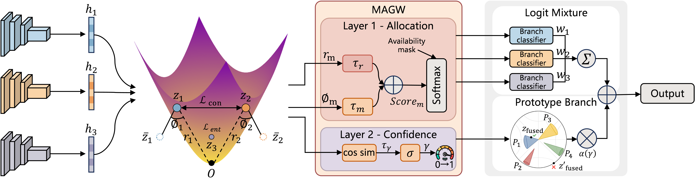

# HyRAF: Reliability-Aware Multimodal Fusion in Hyperbolic Space for Robust Clinical Prediction

Official implementation of our ACM MM 2026 paper: [HyRAF: Reliability-Aware Multimodal Fusion in Hyperbolic Space for Robust Clinical Prediction](https://doi.org/10.1145/3767308.3835477)



## Installation

```bash
conda create -n hyraf python=3.9 -y && conda activate hyraf
pip install torch==2.5.1 torchvision scikit-learn==1.6.1 scipy==1.13.1 nibabel==5.3.3 wfdb==4.3.0 pillow numpy
```

## Quick start

Each command trains and evaluates all five folds. Add `--folds X` to run a single fold.

### AMD

```bash
python -m hyraf.train --dataset amd --data_root /path/to/AMD --gpu 0
```

### MIMIC

```bash
python -m hyraf.train --dataset mimic --data_root /path/to/mimic_csv --ecg_root /path/to/mimic-iv-ecg/1.0 \
    --cxr_root /path/to/mimic-cxr-resized --gpu 0
```

The ECG encoder is initialised from the pretrained ECG ResNet18 of [MERL](https://github.com/cheliu-computation/MERL-ICML2024); place the weights at `pretrained/ecg_res18.pth`.

### ADNI

```bash
python -m hyraf.train --dataset adni --data_root /path/to/ADNI --gpu 0
```

## Citation

```bibtex
@inproceedings{chen2026hyraf,
  title     = {HyRAF: Reliability-Aware Multimodal Fusion in Hyperbolic Space for Robust Clinical Prediction},
  author    = {Chen, Tianao and Chen, Aotian and Xue, Yuan},
  booktitle = {Proceedings of the 34th ACM International Conference on Multimedia},
  year      = {2026},
  doi       = {10.1145/3767308.3835477}
}
```

## License

This project is released under the [CC BY-NC 4.0](LICENSE) license.
